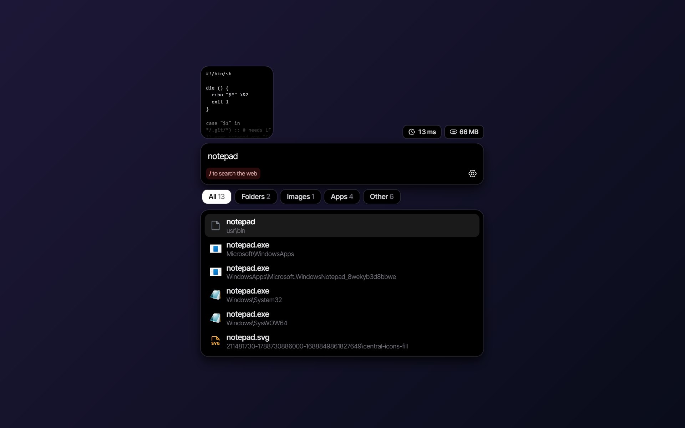
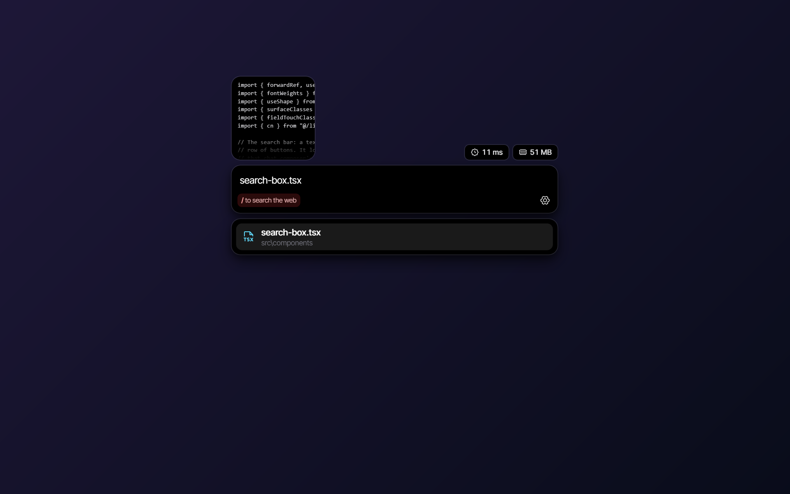
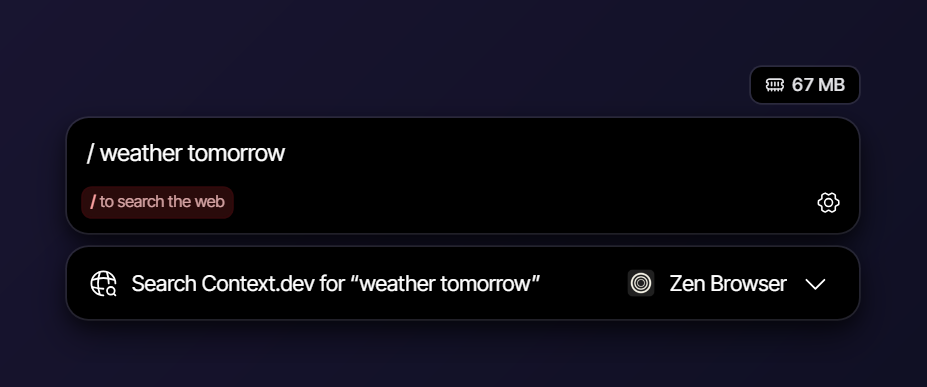

# Better Search

A fast file search for Windows. Press **Alt+S** anywhere, type part of a file name, and press **Enter** to open it.

Better Search reads your drives' file list once and keeps it up to date in the background. Searching never scans your disk, so results appear while you type.

## Features

### File search

- **Every drive, instantly.** Finds any file or folder on your NTFS drives by any part of its name. Several words narrow the search (`invoice 2024`).
- **Inside files.** Start with `\` to find files by the words in them, like `\ tax notes`. It asks Windows Search, which already indexes your documents' contents, so it adds no index of its own and nothing leaves your computer. Choose which folders Windows indexes from settings; you can change the symbol there too.
- **Apps too.** Lists your Start menu apps alongside your files.
- **Smart ranking.** Exact names come first, then apps, shortcuts and folders. Files you open often rise to the top.
- **File type filters.** Press **Tab** to narrow results to folders, documents, images, videos, audio, code, archives or apps.
- **Previews.** See the highlighted result above the search bar: photos, video frames, PDF and Office pages, text and code files, and Word documents even without Office installed.
- **Open or reveal.** **Enter** opens a result and **Ctrl+Enter** shows it in Explorer. You can swap the two in settings.
- **Recent searches.** Your last searches are listed under the empty search box. You can turn this off, which also forgets the ones already kept.

### Typed in the search bar

- **Calculator.** Start or end with `=` to work something out, like `=12*4`. It handles exact decimals, units and percentages offline. **Enter** copies the answer.
- **Websites.** Type an address, like `github.com`, to open it in your browser.
- **Web search.** Start with `/` to search the web. You can change the symbol in settings.
  - Searches open in your choice of Google, Bing, DuckDuckGo, Brave or a custom search URL.
  - Pick the browser they open in. **Tab** switches browsers right in the search.
  - Bring your own API key for Exa, Firecrawl, TinyFish or Context.dev to see web results right in the search window. Your keys are kept in Windows Credential Manager, and the settings page shows each key's usage.

### Snap mode

- Press **Alt+W** to arrange your open windows into a layout: halves, a half and two quarters, two-thirds and a third, or quarters.
- Pick a window for each spot with the arrow keys and **Enter**, then **Ctrl+Enter** to snap them.
- Type to find an app or file for a spot. It's launched or opened when the layout is applied, and its window goes there.
- Windows fill the screen the search opened on, without covering the taskbar.

### Indexing

- **Always current.** A file watcher applies changes as they happen, and changes made while the app was closed are picked up at start-up.
- **Exclusions.** Leave out whole drives, or folders by full path or by name wherever they appear. Caches and build folders are skipped by default.
- **Move the index.** If your Windows drive is short on space, the index can live on another drive and still cover all of them.
- **Rebuild** the index from settings at any time.

### Settings and more

- **Your own shortcut.** Change **Alt+S** to any shortcut you like.
- **Interface size.** Make the search window bigger or smaller on top of Windows' display scaling.
- **Results per search**, clearing the search when it closes, and turning previews on or off.
- **Launch at startup**, with a guided first-run setup.
- **Automatic updates**, checked once a day.
- **Logs** in the Troubleshooting page, for when something goes wrong.

## Screenshots

## Architecture

Better Search is a [Tauri](https://tauri.app) app: a Rust shell with a React interface drawn by WebView2. Small Go programs do the indexing and searching against a SQLite database.

<picture>
  <source media="(prefers-color-scheme: dark)" srcset="docs/diagrams/architecture-dark.svg">
  
</picture>

- **Indexer.** Reads each NTFS drive's Master File Table directly. That's far faster than walking folders, but it needs administrator rights, so it runs as its own short-lived program behind a UAC prompt. It skips caches and build folders (such as `node_modules`, `.git`, browser caches and `WinSxS`), plus any folders you exclude.
- **Search helper.** Answers searches against the index. It frees its memory whenever the window is hidden.
- **File watcher.** Windows tells it about each change (`ReadDirectoryChangesW`), so it uses no CPU between changes. On start-up it checks folder modification times to pick up changes made while the app was closed.

## How search works

<picture>
  <source media="(prefers-color-scheme: dark)" srcset="docs/diagrams/search-dark.svg">
  
</picture>

1. **Index once.** The indexer reads every NTFS drive's file table and stores each file and folder name in a local SQLite database.
2. **Trigram index.** Names go into an FTS5 trigram full-text index, so any part of a name can be found, not just the start. Several words narrow the search (`invoice 2024`).
3. **No disk scans.** A query only touches the index, never the disk.
4. **Ranking.** Exact names come first, then apps, shortcuts and folders, then other files. Files you open often rise to the top.
5. **Stay current.** The watcher applies changes as they happen, so the index doesn't need rebuilding.

### Keeping the index current

<picture>
  <source media="(prefers-color-scheme: dark)" srcset="docs/diagrams/indexing-dark.svg">
  
</picture>

## Privacy

Everything stays on your computer except web search, which only runs once you add your own API key. See the [privacy policy](PRIVACY.md).

## Performance

Measured on a release build with an index of 213,000 files:

| | Result |
|---|---|
| RAM while in the background | 9–17 MB |
| RAM while searching (with previews) | about 105 MB |
| Alt+S until the window shows | about 30 ms |
| Typing until results show | 120–170 ms, including a deliberate 100 ms pause while you type |
| Full index of a drive (2 million file records) | about 10 seconds |
