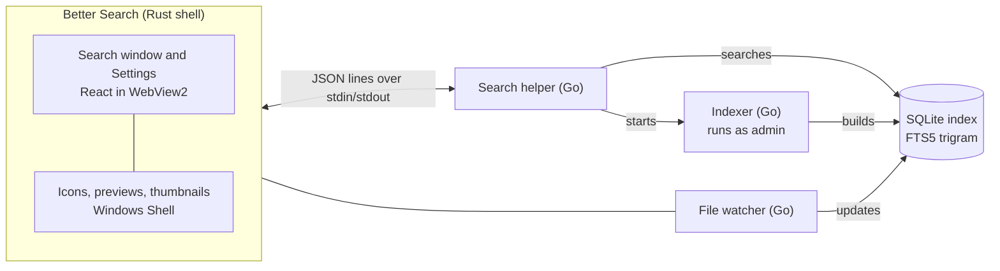
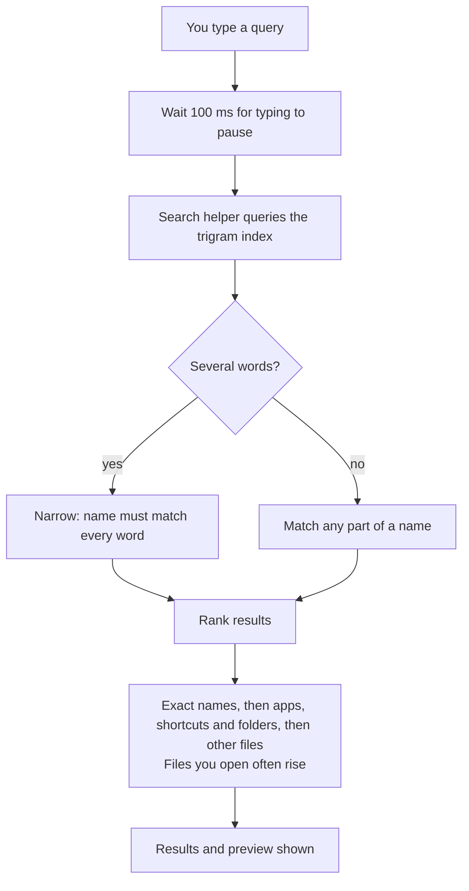
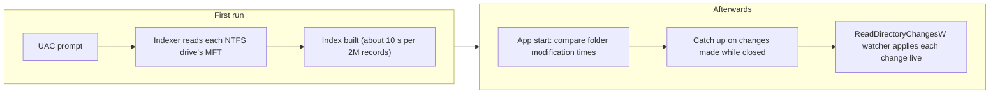

# Better Search

A fast file search for Windows. Press **Alt+S** anywhere, type part of a file name, and press **Enter** to open it.

Better Search reads your drives' file list once and keeps it up to date in the background. Searching never scans your disk, so results appear while you type.

## Screenshots

## Architecture

Better Search is a [Tauri](https://tauri.app) app: a Rust shell with a React interface drawn by WebView2. Small Go programs do the indexing and searching against a SQLite database.

- **Indexer.** Reads each NTFS drive's Master File Table directly. That's far faster than walking folders, but it needs administrator rights, so it runs as its own short-lived program behind a UAC prompt. It skips caches and build folders (such as `node_modules`, `.git`, browser caches and `WinSxS`), plus any folders you exclude.
- **Search helper.** Answers searches against the index. It frees its memory whenever the window is hidden.
- **File watcher.** Windows tells it about each change (`ReadDirectoryChangesW`), so it uses no CPU between changes. On start-up it checks folder modification times to pick up changes made while the app was closed.

## How search works

1. **Index once.** The indexer reads every NTFS drive's file table and stores each file and folder name in a local SQLite database.
2. **Trigram index.** Names go into an FTS5 trigram full-text index, so any part of a name can be found, not just the start. Several words narrow the search (`invoice 2024`).
3. **No disk scans.** A query only touches the index, never the disk.
4. **Ranking.** Exact names come first, then apps, shortcuts and folders, then other files. Files you open often rise to the top.
5. **Stay current.** The watcher applies changes as they happen, so the index doesn't need rebuilding.

### Keeping the index current

## Performance

Measured on a release build with an index of 213,000 files:

| | Result |
|---|---|
| RAM while in the background | 9–17 MB |
| RAM while searching (with previews) | about 105 MB |
| Alt+S until the window shows | about 30 ms |
| Typing until results show | 120–170 ms, including a deliberate 100 ms pause while you type |
| Full index of a drive (2 million file records) | about 10 seconds |
